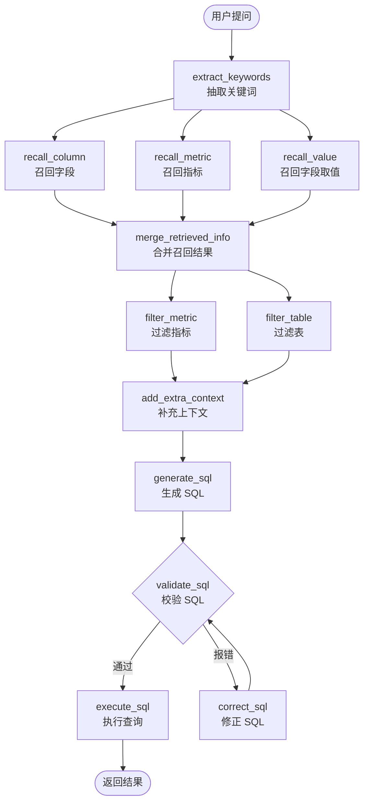

# Data Agent — 基于 LangGraph 的自然语言问数智能体

把一句中文问题（如「2025年各地区平均销售额」）翻译成可执行的 SQL，查数仓、返回结果。

本项目是一个 **NL2SQL（Natural Language to SQL）** 智能体后端。核心思路不是把整张表结构一股脑塞给大模型，而是先用**向量检索 + 全文检索**从元数据知识库里召回相关的表、字段、指标和字段取值，再把收敛后的上下文交给 LLM 生成 SQL，最后校验、纠错、执行。

---

## 核心流程

整个推理过程编排为一张 LangGraph 状态图，共 12 个节点：



三个召回节点**并行执行**，两路过滤也并行。`validate_sql` 是条件边：SQL 合法就走执行，不合法就进入纠错节点，纠错后回到校验，形成自愈循环。

### 为什么这样设计

| 问题 | 做法 |
|---|---|
| 表结构太多，超出上下文窗口 | 先召回，只把相关的表和字段给 LLM |
| 用户说「iPhone」「华北」这类业务黑话 | 用 ES 全文检索字段取值，把口语映射到库里的真实值 |
| 用户问「销售额」而不是 `sales_amount` | 单独维护指标语义层，召回指标定义再翻译成字段 |
| LLM 生成的 SQL 有语法或语义错误 | 校验 + 纠错回环，超过 `fail_count` 次后放弃 |

---

## 技术栈

| 分类 | 选型 |
|---|---|
| Web 框架 | FastAPI + Uvicorn |
| 智能体编排 | LangGraph 1.0 |
| 大模型 | DeepSeek（langchain-deepseek） |
| 关系库 | MySQL 8 + SQLAlchemy 2.0（异步 asyncmy） |
| 向量库 | Qdrant |
| 全文检索 | Elasticsearch 8 |
| 向量化 | BAAI/bge-large-zh-v1.5（1024 维） |
| 分词 | jieba |
| 配置管理 | OmegaConf |
| 日志 | loguru |
| 包管理 | uv |

---

## 目录结构

```
.
├── main.py                     # FastAPI 入口，注册路由、请求 ID 中间件
├── conf/
│   ├── app_config.yaml         # 主配置（数据库 / 向量库 / ES / LLM）
│   └── meta_config.yaml        # 元数据知识库构建配置
├── sql/
│   ├── dw.sql                  # 数仓业务表建表与数据
│   └── meta.sql                # 元数据表（表信息 / 字段信息 / 指标信息）
├── prompts/                    # 各节点的提示词模板
│   ├── generate_sql.prompt
│   ├── correct_sql.prompt
│   ├── plan_sql.prompt
│   ├── filter_table_info.prompt
│   ├── filter_metric_info.prompt
│   └── extend_keywords_*.prompt
├── app/
│   ├── agent/                  # 智能体核心
│   │   ├── graph.py            # LangGraph 状态图定义（节点 + 边）
│   │   ├── state.py            # 状态定义
│   │   ├── context.py          # 运行时上下文（注入各类 Repository）
│   │   ├── llm.py              # LLM 客户端
│   │   └── nodes/              # 12 个节点实现
│   ├── api/                    # 路由层
│   │   ├── routers/query_router.py    # POST /api/query
│   │   ├── schemas/query_schema.py
│   │   └── dependencies.py
│   ├── services/               # 业务服务层
│   │   ├── query_service.py            # 编排图执行，SSE 流式输出
│   │   └── meta_knowledge_service.py   # 知识库构建
│   ├── repositories/           # 数据访问层
│   │   ├── mysql/              # 元数据库 / 数仓
│   │   ├── qdrant/             # 字段、指标向量检索
│   │   └── es/                 # 字段取值全文检索
│   ├── clients/                # 各类客户端连接池管理
│   ├── models/                 # ORM 模型与向量模型
│   ├── conf/                   # 配置加载（OmegaConf → dataclass）
│   ├── core/                   # 日志、生命周期、请求上下文
│   └── scripts/
│       └── build_meta_knowledge.py    # 构建元数据知识库
└── test_cases/                 # 测试题与素材
```

分层依赖单向向下：`api` → `services` → `agent` → `repositories` → `clients`。Repository 通过 `DataAgentContext` 注入到图节点，便于替换和测试。

---

## 快速开始

### 1. 前置依赖

需要提前跑起三个中间件：**MySQL 8**（同时承载元数据库和数仓）、**Qdrant**、**Elasticsearch 8**，以及一个 **Embedding 服务**（bge-large-zh-v1.5，默认 `localhost:8081`）。

> 配套的 `docker-compose` 与前端项目未包含在本仓库中，需另行准备。

### 2. 配置 API Key

**密钥不写在配置文件里**，通过环境变量注入：

```bash
# Windows PowerShell
$env:DEEPSEEK_API_KEY="sk-your-key"

# Windows CMD
set DEEPSEEK_API_KEY=sk-your-key

# Linux / macOS
export DEEPSEEK_API_KEY=sk-your-key
```

`conf/app_config.yaml` 中对应写法为：

```yaml
llm:
  model_name: deepseek-chat
  api_key: ${oc.env:DEEPSEEK_API_KEY,""}
```

未设置时该值为空字符串，配置能正常加载，但调用大模型会失败。

### 3. 安装依赖

```bash
uv sync
```

### 4. 初始化数据库

依次导入元数据表和数仓表：

```bash
mysql -u root -p < sql/meta.sql
mysql -u root -p < sql/dw.sql
```

### 5. 构建元数据知识库

把表结构、字段说明、指标定义写入 Qdrant 向量库和 ES 索引：

```bash
uv run -m app.scripts.build_meta_knowledge
```

这一步是问数效果的前提 —— 召回质量取决于知识库建得好不好。

### 6. 启动服务

```bash
uv run -m main
```

服务监听 `http://127.0.0.1:8000`。

---

## 接口说明

**POST** `/api/query`

请求体：

```json
{
  "query": "华北地区销售总额"
}
```

响应为 **SSE 流式**（`text/event-stream`），按节点逐步推送执行过程，便于前端实时展示「正在召回字段 → 正在生成 SQL → 正在执行」的进度。

```bash
curl -N -X POST http://127.0.0.1:8000/api/query \
  -H "Content-Type: application/json" \
  -d '{"query":"华北地区销售总额"}'
```

---

## 示例问题

- 华北地区销售总额
- 2025年各地区平均销售额
- 各个地区iPhone去年卖了多少钱

第三个问题最能体现设计意图：「iPhone」是口语说法，需要经 ES 召回映射到库里的真实商品名；「去年」需要模型结合当前时间做相对时间推算。

---

## 说明

- `conf/app_config.yaml` 中的数据库账号密码为本地开发默认值，生产环境请改用环境变量或密钥管理服务。
- `test_cases/` 下为课程练习阶段的测试题素材，与运行逻辑无关。
- `notes.md` 为开发过程中的学习笔记。
