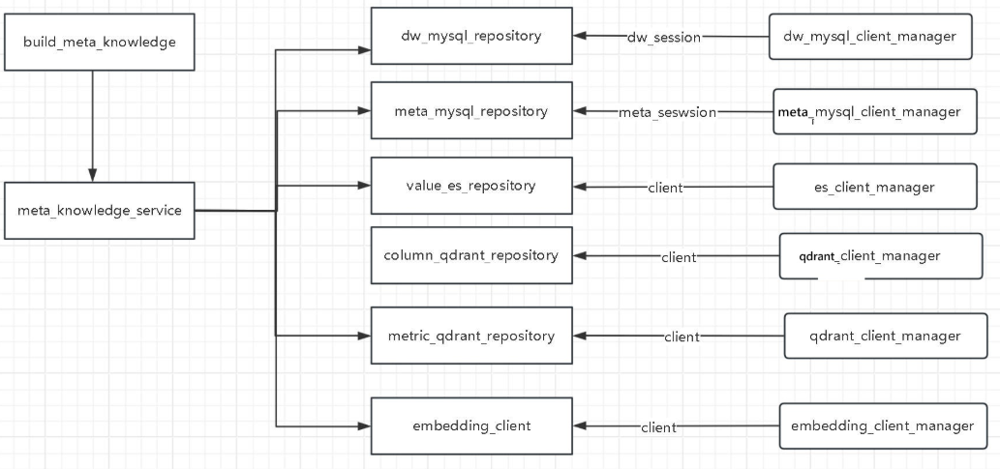

### 1. 区别问数项目与智库项目

- 掌柜智库：doc RAG
- 掌柜问数：db RAG   NL2SQL 

### 2. 区别数据仓库与业务数据库？

- 业务仓库(业务数据库):  对接前台用户，当用户操作时，实时对数据库进行CRUD操作
- 数据仓库(数仓)： 用于数据分析， 保存的是业务数据库中的历史数据，每隔一定的时间将业务数据库中的新的数据
  	读取出来后，处理后再插入到数仓中，一般不做更新和删除

### 3. 说说问数项目的2个阶段

- 索引： 将数仓的元数据保存到元数据库（mysql），并对字段信息和指标信息进行向量索引，对字段值进行全文索引
- 检索：根据用户的提问从索引库中匹配相关的元数据，交给LLM生成SQL, 执行SQL从数仓中查询得到需要的数据

### 4. 区别一下json与yaml

- yaml： 
  语法简洁，易读， 可以写注释  =》 配置文件使用
  不能简化为一行编写
- json:
  语法相对复杂，不太易读， 不可以写注释
  可以在一行编写  =》 前后台传输数据基本都用json

### 5. 说说OmegaCof库的2个作用

1. 可以将yaml的对象数据转换为指定类型的对象 =》 读取属性时可以有提示
2. 对属性名和属性值的类型有限定，防止错误

### 6. GIT管理项目的基本操作

```
创建本地仓库
	git init
	git add .
	git commit -m "日志"
创建远程仓库
	在gitee上创建远程仓库（空）
将本地仓库推送到远程仓库
	git remote add origin url
	git push origin master 
如果本地代码有更新，先提交到本地仓库，再推送远程仓库
	git add .
	git commit -m "日志"
	git push origin master
如果远程代码有更新，拉取到本地	
	git pull origin master
克隆仓库（进公司的第一天）
	git clone url
```


### 7. 后端项目的三层架构

- 表现层/接口层(api)
  一般就是使用FastAPI来定义多个接口路由
  得到前台用户提交的请求参数数据
  调用业务层处理业务逻辑
  向前台返回结果数据
- 业务层(services)
  调用持久层的多个方法对数据库数据进行多个CRUD操作
  进行各种业务逻辑的处理
- 持久层(repositories)
  定义了对数据库数据进行CRUD操作的多个方法
  使用ORM框架来简化数据库的操作，不用写SQL语句， 而是基于对象进行操作
  ORM：Object Relation Mapping

### 8. 说说SQLAlchemy库的特点

- 面向关系型数据库的ORM框架
- 可以不用写SQL，直接基于对象进行数据库操作（内部生成SQL执行）
- 内部维护连接池，提高运行效率

### 9. 说说SQLAlchemy库中的下面几个配置的作用

- pool_size：连接池大小， 初始化的常驻连接数
- max_overflow：最大临时连接数
- autoflush： 是否自动将未提交的数据保存到暂存区（查询可以获取）
- autobegin： 是否自动开启事务

### 10. 说说Qdrant的作用

- 开源的向量数据库
- 高维向量数据存储和相似度查询
- 注意：本身并不能生成向量

### 11. 说说Hugging Face的作用

- 实现生成向量的推理服务
- 配合嵌入模型进行向量的批量生成

### 12. 说说ContextVar的理解

- 协程安全的上下文变量
- 每个协程都有自己的上下文对象context，互不干扰，可以向其中独立设置和获取不同变量名的数据
- contextVar对象是多个协程context对象的代理对象，代理对当前协程context对象数据的操作
  - ContextVar(key, default=val): 创建contextVar对象，指定数据的key的初始值
  - set(data)->token：保存数据
  - get()->data：读取数据
  - reset(token)：重置数据
- 项目中的应用：保存请求id，在打印日志时输出当前请求的id，区别不同请求的日志

### 13. 说说日志模块的功能特点

- 定制日志输出格式，控制输出级别
- 自动将日志内容保存到日志文件
- 指定日志文件的最大大小，一旦超过自动创建一个新的的文件
- 指定文件的有效期，过了自动删除
- 记录当前日志输出是哪个请求的，记录请求id


### 14. 说说你对ES的理解

- 开源的全文搜索引擎
- 多节点（多服务器集群）、多切片（分布式）、多副本、超大数据量索引存储(可PB级)
- 倒排索引：分词=》合并 =》排序
- 检索：提问分词 =》匹配索引分词，得到对应的docid => 根据docid找到文档数据

### 15. 解释一下ES中的索引、文档和字段

- 索引： 表 / 列表
- 文档： 行数据 / 对象
- 字段：表的列 / 对象属性

### 16. 什么是REST API

- REST
  一个接口路径可以对应多个不同请求, 通过不同的请求方式对应不同后台操作
  GET  获取数据
  Delete  删除数据
  POST/PUT  添加/更新
  http://localhost:3000/user/1
- 非REST
  一个接口路径只对应一个请求，后台只能有一个处理
  http://localhost:3000/getUserById?id=1

### 17.  ES的查询

- 单条件查询
  query：查询
  match: 分词匹配 =》分词后匹配索引
  term：精确匹配 =》不分词匹配索引
  range：匹配数值区间
- 多条件组合查询
  bool: 使用组合查询
  must: 都满足
  should: 只要满足一个
  must_not: 都不满足
  fitler: 都满足，但不记录得分

### 18. 说说构建知识库相关的模块及关系




### 19. 构建知识库的同步脚本（入口脚本）的执行流程

1. 初始化各个客户端管理器
2. 创建业务对象及其依赖对象 
   创建针对dw和meta库的2个session对象 
   创建各个持久层对象
   创建构建知识库的业务对象
3. 调用构建知识库的业务方法
4. 如果成功了，提交事务，如果失败了，回滚事务，抛出错误
5. 无论成功还是失败，都要关闭各个客户端

### 20. 构建知识库的业务函数的执行流程

    1. 处理表信息和字段信息
        1.1. 将表信息和字段信息保存到meta库（table_info,column_info）
        1.2. 将字段信息保存到qdrant库中建立向量索引
        1.3. 将字段值保存到es库中建立全文索引
    2. 处理指标信息
        2.1. 将指标信息保存到meta库（metric_info和column_metric）
        2.2. 将指标信息保存到qdrant库中建立向量索引


### 21. 说说Graph中的几个核心组件

- 节点: 实现特定功能的函数
- 边: 它是A->B2个节点的连线, A执行后执行B，且将最新的状态数据传递给B
- 状态: 包含多个可变数据的对象，在图的各个节点上传递
- 上下文：包含多个不可变数据的对象（依赖模块对象），在图的各个节点上传递
- 图: 通过边连接起来的所有节点组成的结构对象，通过图可以按流程执行所有节点

### 22. 说说节点函数的几个重要参数

- state: 状态对象，   自定义类型
- runtime: Runtime  运行时对象，包含:
  - stream_writer: 向调用者输出自定义数据的函数    =》stream_mode指定为custom
  - store:实现跨会话长期记忆的对象，默认是保存在内存中
  - context: 包含固定数据或依赖的外部模块的对象   自定义类型
- config：ConfigRunnable 保存配置的对象，比如执行时指定的thread_id

### 23. Graph编码的基本流程

- 创建状态图
- 定义节点，并添加节点
- 添加边
- 编译状态图
- 执行图   invoke/ainvoke / stream / astream()

### 24. 说一下项目中Graph编排的整个节点流程

- 提取关键词
- 3路召回：字段召回，指标召回，字段值召回
- 合并3路召回
- 2路过滤：过滤表和字段，过滤指标
- 添加额外信息
- 生成SQL，校验SQL，校正SQL，执行SQL


### 25. 说下提取关键字节点的功能

- 利用Jiaba库对用户提问进行字面的关键字提取 =》可能会丢失语义
- 将用户提问合并到关键字列表中 =》防止语义丢失


### 26. 说下三路召回节点的实现

- 召回字段：
  - 使用大模型对提问进行语义化提取关键字词并与jiaba提取的关键字进行去重合并   keywords
  - 将所有关键字转换为向量
  - 根据关键字向量去qdrant库中进行相似度匹配得到相关的字段信息列表，并进行去重合并  recall_columns
- 召回指标
  - 使用大模型对提问进行语义化提取关键字并与jiaba提取的关键字进行去重合并   keywords
  - 将所有关键字转换为向量
  - 根据关键字向量去qdrant库中进行相似度匹配得到相关的指标信息列表，并进行去重合并 recall_metrics
- 召回字段值
  - 使用大模型对提问进行语义化提取关键字并与jiaba提取的关键字进行去重合并   keywords
  - 根据关键字去es库中进行字段值的全文模糊匹配得到字段值信息列表，并进行去重合并  recall_values

### 27.  说下合并召回节点的实现

1.收集一个最完整的字段信息列表 去重合并 dict[column_id,ColumnlnfoQdrant]
	1.1.收集召回的字段信息列表
	1.2.收集召回的指标信息列表联的字段信息列表
	1.3.收集召回的字段值信息列表对应的字段信息列表=》将字段值保存到字段的值的样例列表中
	1.4.收集相表的主键和外键字段信息列表
2.根据收集所有字段信息列表生成:带字段信息列表的表信息列表
	2.1.对收集的字段信息列表进行按表id进行分组:dict[table_id, list[ColumnlnfoQdrant]]
	2.2.生成带字段信息列表的表信息列表 -》table_infos:list[TablelnfoState]
   		 根据表id查询meta得到表信息
  	 	 根据当前字段信息列表·生成ColumnlnfoState类型的字段状态信息列表

### 28. 说说合并召回后的节点实现

- 过滤表信息节点：利用大模型来过滤掉table_infos中多余的table和column
- 过滤指标信息节点：利用大模型来过滤掉metric_infos中多余的metric
- 添加额外信息节点：添加当前日期和数据库版本和名称信息
- 生成SQL: 根据前面收集的数据（qeury/table_infos/metric_infos/date_info/db_info）让大模型生成SQL
- 校验SQL: 
  - 如果失败次数已达到最大限制，抛出错误，显示到前台
  - 利用explain来检查生成的查询SQL的语法正确性, 如果失败，返回error跳转去校正SQL，失败次数加1， 如果成功跳转去执行SQL
- 校正SQL:  根据前面收集的数据和sql/error, 让大模型重新生成一个新的SQL，跳转到校验SQL
- 执行SQL：去dw库中执行生成的SQL，输出包含所有匹配行数据的列表


### 29. 说说FastAPI中的接口的参数

1. path参数：路径中可变的的部分，有对应的占位名称，对应的参数与占位名称一致
2. body参数：json格式，对应的参数必须是BaseModel类型
3. query参数: 请求路径中？后面的参数，对应的参数就是路由函数其它参数

### 30. 说说FastAPI的流式输出

- 基于SSE协议实现
- 路由函数返回流动响应对象StreamingResponse, 一定要指定类型为：text/event-stream
- 流式输出函数：包含yield的async函数  =》异步生成器  
- 返回的数据格式："data: json数据 \n\n"

### 31. 说说FastAPI中的生命周期与中间件

- 生命周期
  	在应用启动时和应用停止前执行一次的特定函数
  	函数中yield之前的代码在启动时执行：做一次的初始化工作 =》初始化客户端Mananger
  	函数中yield之后的代码在停止前执行：做一次性的收尾工作 =》关闭客户端Manager
- 中间件
  	在每个处理请求的路由函数执行前和执行后执行的特定函数
  	函数中call_next()执行前的代码在处理请求前执行  =》向contextVar对象中保存一个当前请求的id
  	函数中call_next()执行后的代码在处理请求后执行

### 32. 说说FastAPI中的依赖注入

- 描述：路由函数依赖的特定对象我们不在路由函数中直接创建，而是通过声明依赖参数的形式，让框架自动创建并注入进来
- 作用：将创建依赖对象的代码写死，而是由依赖函数在外部创建再通过参数传入

### 33. 理解FastAPI中的路由和路由器

- 路由：一个路由就对应一个接口，包含请求路径，请求方式和处理请求函数 路由函数
- 路由器： 管理多个路由的对象， 方便对多个路由进行分组管理


